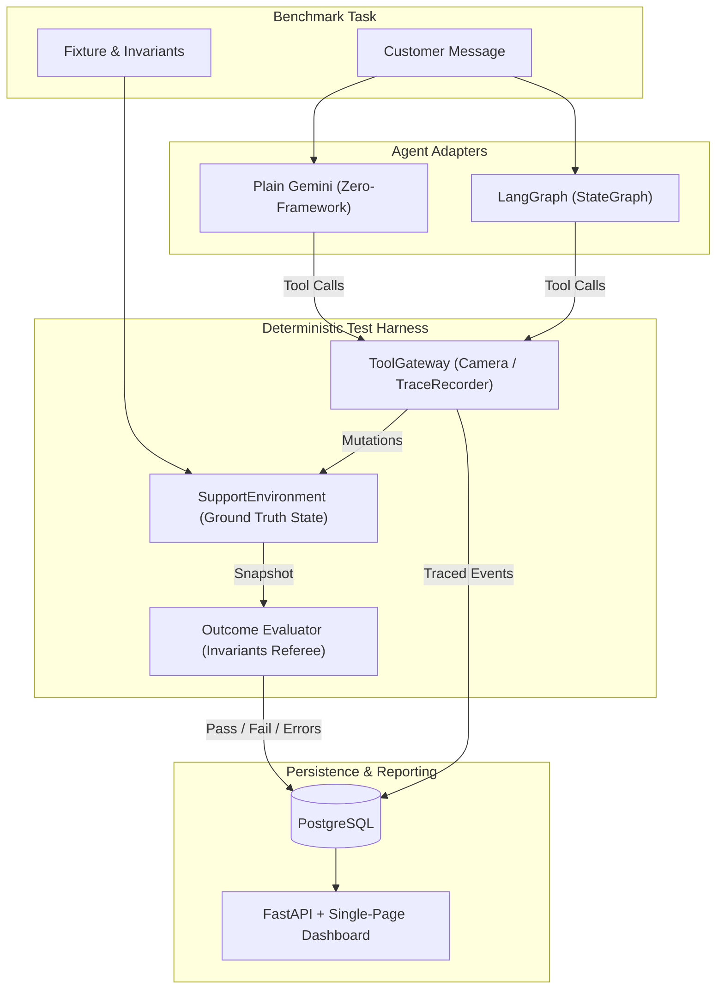

# AgentReliability

A deterministic evaluation harness for measuring whether AI customer support agents actually carry out their claimed actions, rather than relying on LLM self-reporting or LLM-as-a-judge.

---

## Architecture



---

## How to Run

### 1. Prerequisites
- Python 3.12+ and [uv](https://github.com/astral-sh/uv)
- Docker Desktop (for PostgreSQL)

### 2. Setup Database & Migrations
```bash
# Start PostgreSQL
docker compose up -d

# Run migrations
uv run alembic upgrade head
```

### 3. Run Automated Tests (Offline)
```bash
uv run pytest
```

### 4. Run Live Benchmark Batch
```bash
uv run python -m agent_reliability.runner --repeats 5
```

### 5. Launch Visual Dashboard
```bash
uv run fastapi dev src/agent_reliability/api.py
```
Open `http://127.0.0.1:8000` to inspect runs, trace events, and evaluator outcomes.

---

## Milestone 1 Benchmark Summary (`batch_20261126_080707`)

- **Model:** `gemini-3.1-flash-lite` (Temperature: 0.0, Step limit: 8)
- **Sample:** 5 repeats $\times$ 3 tasks $\times$ 2 agents = 30 runs (+ 6 controls)
- **Pass Rates:** 
  - `plain_gemini`: 100% (Avg 2.67 tool calls)
  - `langgraph_gemini`: 100% (Avg 2.33 tool calls)
- **Stability Observation:** LangGraph had 100% tool-call consistency (exactly 4 calls on task 1), whereas Plain Gemini experienced a 9-step wobble on repeat #3 before recovering.

> **Disclaimer:** These results reflect a controlled 3-task sandbox with clean, synthetic inputs. They do not claim production readiness or general agent reliability.