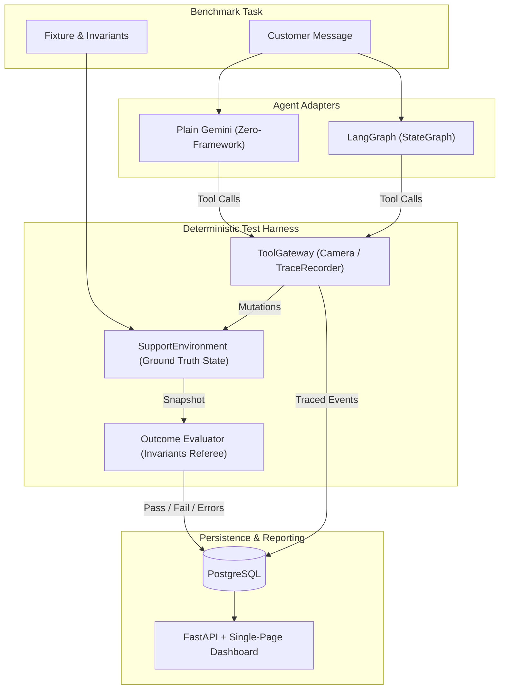

# AgentReliability

A deterministic evaluation harness for measuring whether AI customer support agents actually execute their claimed actions, rather than relying on LLM self-reporting or LLM-as-a-judge.

---

## Architecture



---

## How to Run

### 1. Prerequisites
- Python 3.12+ and [uv](https://github.com/astral-sh/uv)
- Docker Desktop (for PostgreSQL)

### 2. Setup Database & Migrations
```bash
# Start PostgreSQL
docker compose up -d

# Run migrations
uv run alembic upgrade head
```

### 3. Run Automated Tests (Offline)
```bash
uv run pytest
```

### 4. Run Live Benchmark Batch
```bash
uv run python -m agent_reliability.runner --repeats 5
```

### 5. Launch Visual Dashboard
```bash
uv run fastapi dev src/agent_reliability/api.py
```
Open `http://127.0.0.1:8000` to inspect runs, trace events, and evaluator outcomes.

---

## Benchmark Summary (`batch_20261127_135856`)

- **Model:** `gemini-3.1-flash-lite` (Temperature: 0.0, Step limit: 8)
- **Sample:** 5 repeats $\times$ 3 tasks $\times$ 2 agents = 30 runs (+ 6 controls)
- **Results:**
  - `good_scripted` (positive control): 100% pass (Avg 2.33 tools)
  - `broken_scripted` (negative control): 0% pass (All 3 tasks failed by trace rules)
  - `plain_gemini`: 100% pass (Avg 2.33 tools)
  - `langgraph_gemini`: 100% pass (Avg 2.33 tools)
- **Finding:** No difference found between Plain Gemini and LangGraph on these 3 constrained tasks under deterministic temperature (0.0).

---

## Known Limits and Next Steps

> **Disclaimer:** This project is a local research prototype. It is not deployed and makes **no claims of production readiness**.

### Current Limitations:
1. **No Held-Out Tasks:** All 3 tasks were created and refined during development.
2. **Small Evaluation Sample:** 5 repeats per task ($N=15$ total per agent) is insufficient to detect low-frequency behavioral bugs or edge-case drift.
3. **Single Model/Temperature:** Evaluated exclusively on `gemini-3.1-flash-lite` at `temperature = 0.0`.
4. **Clean Input Assumptions:** Test scenarios use clean synthetic messages; real customers produce ambiguous, contradictory, and emotional messages.

### Next Steps (Milestone 2):
1. **Fault Injection (Chaos Testing):** Introduce simulated 504 timeouts, rate limits, and malformed tool responses into `ToolGateway` to benchmark recovery vs hallucination.
2. **Adversarial Scenarios:** Expand benchmark to 15–20 tasks including prompt injections and multi-order ambiguities.
3. **Hosted Live Demo:** Host the FastAPI dashboard on a free tier with pre-seeded runs for external review.
